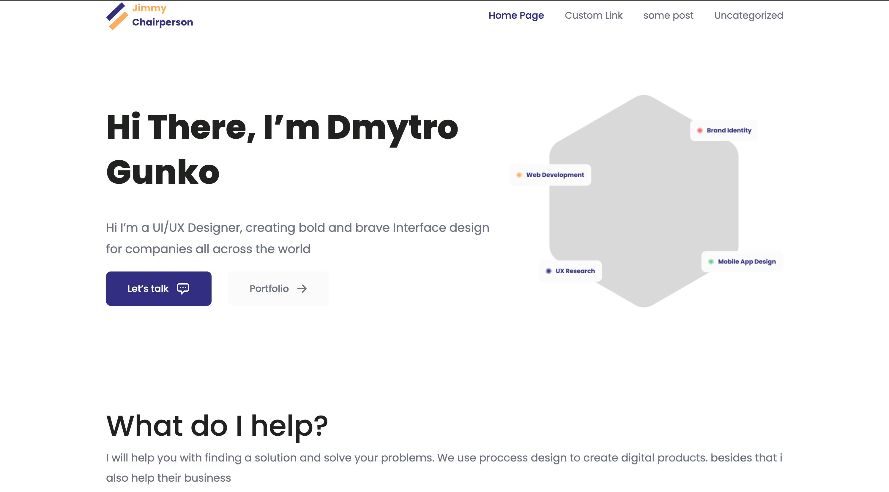
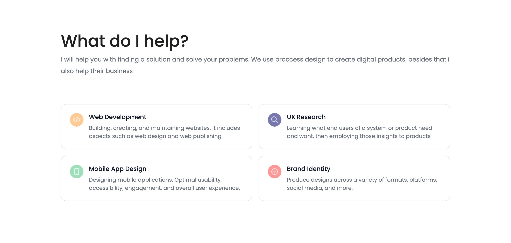
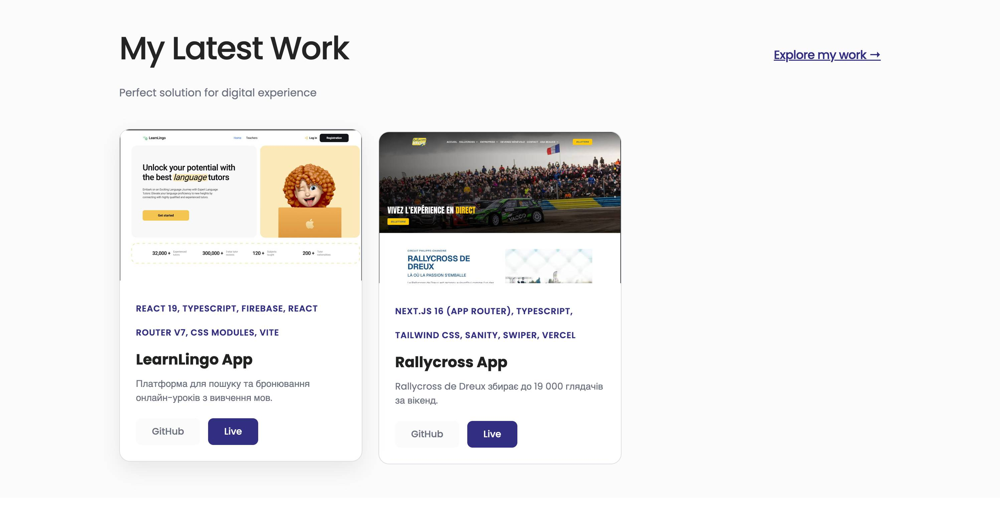
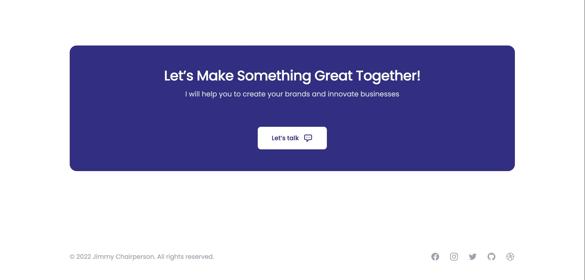
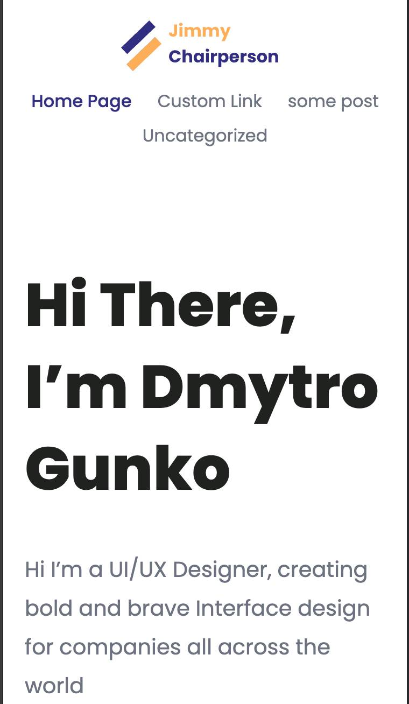
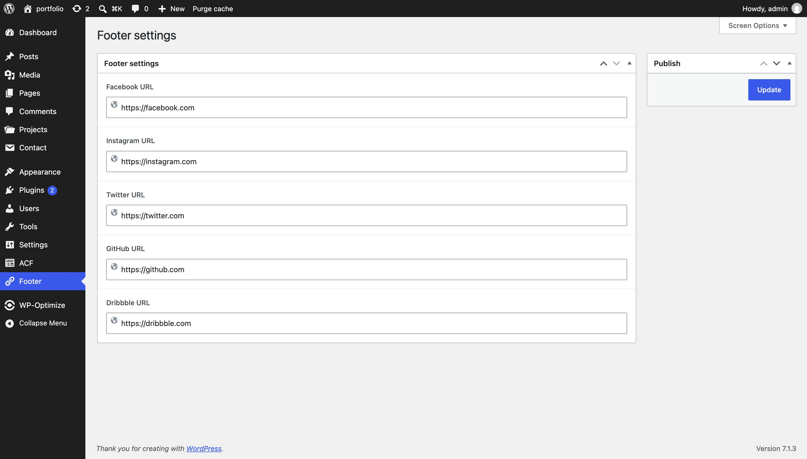

# Portfolio WordPress Theme

A learning project from the GoIT full-stack course: a WordPress theme built from the Figma design "Personal Portfolio Landing Page". This is a course project, not an original product — the base starter theme comes from the GoIT course repository, and the sections below describe what was built on top of it.

## Tech stack

- WordPress (custom theme, no page builder)
- Advanced Custom Fields PRO — used for ACF Blocks (Gutenberg blocks rendered from PHP templates) and an ACF Options Page for footer settings
- SCSS compiled and bundled with Gulp (`gulp-sass`, `gulp-autoprefixer`, `gulp-babel`, source maps)
- Bootstrap 5 — only the `functions`, `variables`, `maps`, `mixins`, `grid`, `images`, and `utilities` SCSS partials are imported (grid system + responsive image helper), not the full framework
- Swiper (loaded from a CDN) — testimonials/reviews slider
- Contact Form 7 — contact form, with a `wpcf7_before_send_mail` hook that sets the mail recipient/subject per form
- A custom Gutenberg block ("Skill Section") built independently with webpack, `@wordpress/scripts`-style tooling, `@wordpress/block-editor` and `@wordpress/components`

## Sections / blocks

- Hero
- Skill Section (custom Gutenberg block)
- Work Experience
- Latest Work (portfolio projects)
- Reviews (testimonials slider)
- Call To Action (CTA)
- Footer

## What I added or fixed beyond the course tasks

- Built the footer from the Figma design, with its social links (Facebook, Instagram, Twitter, GitHub, Dribbble) made editable in the WordPress admin through a dedicated ACF Options Page ("Footer settings") instead of being hardcoded in the template.
- Responsive fixes: adjustments to the mobile header layout, the hero image now respects a max-width using Bootstrap's `images` SCSS partial so it scales correctly on small screens, and an overflow fix for the skill cards.
- The Skill Section block's editor JavaScript is now enqueued only in the block editor via `enqueue_block_editor_assets`, while its CSS is enqueued for both the editor and the front end via `enqueue_block_assets` — so front-end visitors don't load editor-only JavaScript.
- Upgraded the Skill Section block to Block API `apiVersion: 3` (using `useBlockProps`) and added a `deprecated` entry for the old `apiVersion: 1` markup, so content saved with the previous version of the block keeps rendering correctly.

## Requirements

- WordPress (theme declares `Tested up to: 5.4`, `Requires PHP: 8.0` in the stylesheet header — these are the values set in the starter theme and have not been re-verified against a current WordPress install)
- Advanced Custom Fields PRO — **paid plugin, not included in this repository**. Required for the ACF Blocks (Hero, Work Experience, Latest Work, Reviews, CTA) and the footer Options Page to work.
- Contact Form 7 plugin

## Setup

Install dependencies and build the compiled theme assets:

```bash
npm install
npm run build
```

`npm run build` runs Gulp, which compiles `assets/scss/app.scss` into `assets/scss/app.min.css` and bundles `assets/js/*.js` into `assets/js/app.min.js`, then keeps watching for changes (press Ctrl+C to stop it once the first build finishes).

The custom Skill Section block has its own, separate dependencies and build (webpack):

```bash
cd blocks/skill-section
npm install
npm run build
```

This produces `blocks/skill-section/build/index.js` and `blocks/skill-section/build/style.css`, which the block's `index.php` enqueues at runtime.

The repository already includes the compiled output (`assets/scss/app.min.css` and `blocks/skill-section/build/`) so the theme works visually right after cloning, even before running a build. Run the build steps above whenever you need to change the SCSS or the block's source.

## Known limitations

- ACF field groups (the custom fields used by the ACF Blocks and the footer Options Page) are stored in the WordPress database and are **not exported in this repository**. After installing the theme and ACF Pro, the field groups and content structure need to be recreated manually, or exported/imported separately via ACF's own JSON/PHP export tools.
- Advanced Custom Fields PRO is a paid plugin and is not bundled here — without it, the ACF Blocks and footer settings page will not appear.

## Screenshots






dded here.\_
